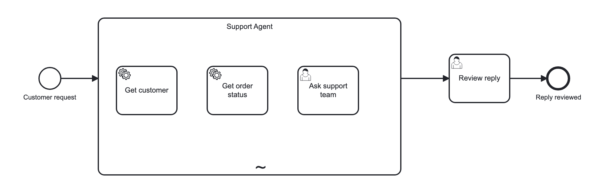
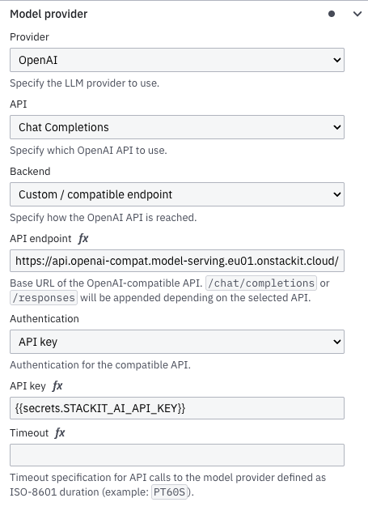

# camunda-ai-agent-stackit-example
Camunda 8 agentic orchestration example: the AI Agent connector on STACKIT AI Model Serving, the OpenAI-compatible LLM service of the German sovereign cloud. A BPMN process, element templates and a Spring Boot worker show how to run AI agents in Camunda while prompts and process data stay in Germany. GDPR-friendly, Java, ready to fork.

A customer support agent for a fictional online shop. The agent looks up customers and orders with two job-worker tools and asks a human of the support team when it is unsure. A human reviews the drafted reply.

<p align="center">
  
</p>

## Requirements

- JDK 21, Maven 3.9
- Docker
- A STACKIT project with AI Model Serving and an API token

## Get a token

```sh
stackit curl -X POST https://model-serving.api.eu01.stackit.cloud/v1/projects/<project-id>/regions/eu01/tokens \
  --data '{"name":"camunda-ai-agent","ttlDuration":"336h"}'
```

The token content is shown once. Copy `.env.example` to `.env` and set `STACKIT_AI_API_KEY`.

## Models

Shared models in eu01 as of 2026-11-11. Specs from [Available shared models](https://docs.stackit.cloud/products/data-and-ai/ai-model-serving/basics/available-shared-models/), prices from the STACKIT portal pricing 
information (EUR per 1M tokens). The model ID is the value for the `model` variable or `provider.openai.model.model` in the BPMN.

| Model ID                                     | Type      | Tier     | Context  | Max output | Tool calling | Input €/1M | Output €/1M | Note                                      |
|----------------------------------------------|-----------|----------|----------|------------|--------------|------------|-------------|-------------------------------------------|
| `openai/gpt-oss-20b`                         | chat      | Standard | 131K     | 8192       | yes          | 0.15       | 0.25        | default, verified                         |
| `openai/gpt-oss-120b`                        | chat      | Plus     | 131K     | 16384      | yes          | 0.45       | 0.65        |                                           |
| `cortecs/Llama-3.3-70B-Instruct-FP8-Dynamic` | chat      | Plus     | 128K     | 4096       | yes          | 0.45       | 0.65        |                                           |
| `google/gemma-4-31B-it`                      | chat      | Plus     | 256K     | 16384      | yes          | 0.45       | 0.65        | text + image input                        |
| `google/gemma-3-27b-it`                      | chat      | Plus     | –        | –          | –            | 0.45       | 0.65        | served and priced, not in the models docs |
| `Qwen/Qwen3.8-27B`                           | chat      | Plus     | 262K     | 16384      | yes          | 0.45       | 0.65        | text + image input                        |
| `Qwen/Qwen3-VL-235B-A22B-Instruct-FP8`       | chat      | Premium  | 200K     | 16384      | yes          | 1.50       | 1.75        | text + image input                        |

Billing is pay-per-token in units of 1M tokens per day: a day with fewer than 1M tokens is charged as a full 1M. Prices change; check the portal.

List the IDs your token can use:

```sh
curl -s -H "Authorization: Bearer $STACKIT_AI_API_KEY" \
  https://api.openai-compat.model-serving.eu01.onstackit.cloud/v1/models | jq -r '.data[].id'
```

The agent needs a chat model with tool calling. STACKIT recommends retries for tool calling; the agent task has 3 retries.

Switch the model per instance:

```json
{"processDefinitionId":"stackit-support-agent","variables":{"request":"Where is my order 4711?","model":"openai/gpt-oss-120b"}}
```

## Run

```sh
docker compose up -d
mvn spring-boot:run
```

Start an instance:

```sh
curl -X POST http://localhost:8080/v2/process-instances \
  -H 'Content-Type: application/json' \
  -d '{"processDefinitionId":"stackit-support-agent","variables":{"request":"Where is my order 4711?"}}'
```

Open Operate and Tasklist at http://localhost:8080 (demo / demo). The agent may create an `Ask support team` task; afterwards `Review reply` shows the drafted reply.

## Build and test

```sh
mvn verify
```

The default build has no Docker, no Spring context and no model calls. `SupportAgentProcessTest` checks the BPMN statically, `ShopToolsTest` the job workers.

### Agent tests with an LLM judge

`SupportAgentJudgeIT` runs the process in Camunda Process Test (Testcontainers, connectors runtime) against the live STACKIT model. An LLM judge then grades the generated prompts and replies against expectations written in plain language:

- the `reply` shown in `Review_Reply`: facts from the tools, no invented order data, the customer's language, tone
- the `question` the agent writes for `Ask_Support_Team`, i.e. the output of the `fromAi` prompt

| Test case         | Customer request                                                | Support team answer (if asked)              | Judge expects                                                                                                                                                              |
|-------------------|-----------------------------------------------------------------|---------------------------------------------|----------------------------------------------------------------------------------------------------------------------------------------------------------------------------|
| Shipped order     | `Where is my order 4711?`                                       | answer from order data only                 | `reply` in English and brief: shipped with DHL, arriving 14 Nov 2026; no other carrier, status or date. `Get_Order_Status` was called.                                     |
| Customer language | `Hallo, wo ist meine Bestellung 4713?`                          | answer from order data only                 | `reply` in German: delivered by UPS, on 9 Nov 2026 if a date is given. `Get_Order_Status` was called.                                                                      |
| Unknown order     | `Where is my order 9999?`                                       | no order 9999, check the confirmation email | `reply` says the order was not found and asks for the order number; no invented status, carrier or date.                                                                   |
| Human in the loop | `My order 4712 is taking forever. I want a 20% discount on it.` | no 20%, offer a 10% voucher, code `SORRY10` | `Ask_Support_Team` was called. Its `question` names order 4712 and the 20% request with enough context. `reply` offers the 10% voucher `SORRY10` and does not promise 20%. |

In every test case the judge also checks that `reply` is polite: courteous and respectful, also towards an impatient customer, no blame, sarcasm or curt wording. It is a separate assertion, so a rude reply fails on its own.

The support team answer is a CPT conditional behavior that completes `Ask_Support_Team`. It fires only if the agent picks that tool. Each test stops at the active `Review_Reply` task.

### Set up the agent and judge tests

Two models take part in each test:

| Role  | Runs where                                     | Model                                                                      | Configured in                                                               |
|-------|------------------------------------------------|----------------------------------------------------------------------------|-----------------------------------------------------------------------------|
| Agent | AI Agent connector in the connectors container | `openai/gpt-oss-20b`, the BPMN default (the tests set no `model` variable) | `provider.openai.model.model` in `support-agent.bpmn`                       |
| Judge | test JVM, Camunda Process Test                 | `openai/gpt-oss-120b`, override with `JUDGE_MODEL`                         | `camunda.process-test.judge` in `src/test/resources/application-judge.yaml` |

Both call STACKIT with the same `STACKIT_AI_API_KEY`. A stronger judge than agent makes the grading more reliable.

1. **Prerequisites.** Docker running, JDK 21, Maven 3.9, and `.env` with `STACKIT_AI_API_KEY` (see [Get a token](#get-a-token)).
2. **Dependency.** `camunda-process-test-spring-boot-4` (test scope) brings Camunda Process Test, Testcontainers and the LangChain4j judge adapter. Nothing else to add.
3. **Runtime.** `application-judge.yaml`, active through `@ActiveProfiles("judge")`, starts Camunda `8.10.9` and `camunda/connectors-bundle:8.10.5` with `connectors-enabled: true`, so the real AI Agent connector runs. `ShopTools` job workers run in the test JVM.
4. **Agent secret.** `connectors-secrets.STACKIT_AI_API_KEY` hands the key to the connectors container, where `{{secrets.STACKIT_AI_API_KEY}}` in the BPMN resolves it.
5. **Judge.** `judge.chat-model` with `provider: openai-compatible`, the STACKIT `base-url`, `api-key`, `model`, `temperature: 0.0`. `judge.threshold: 0.75` (0.0 to 1.0, default 0.5). Override per assertion with `withJudgeConfig(config -> config.withThreshold(...))`.
6. **Assertion timeout.** `assertion.timeout: PT2M`, because one agent run makes several model calls.
7. **Build profile.** The `judge` Maven profile adds the failsafe plugin for `*IT` classes. The default `mvn verify` does not run them.

Run from the terminal:

```sh
set -a; source .env; set +a
mvn -Pjudge verify
```

Run from IntelliJ: IntelliJ does not read `.env`. Add `STACKIT_AI_API_KEY=<token>` under **Environment variables** of the `SupportAgentJudgeIT` run configuration, or of the JUnit template in **Edit configuration templates…** for all new runs. Without the variable the tests are skipped. If the connectors log shows `fetching secrets failed: PlaceholderResolutionException`, the key did not reach the test JVM and the container got the unresolved `${STACKIT_AI_API_KEY}`.

Add a test case:

1. Register the support team answer with `supportTeamAnswers(...)` before starting the instance.
2. Start with `start("<customer request>")`.
3. Wait for `hasActiveElements("Review_Reply")`, assert the tools with `hasCompletedElements(...)`.
4. Judge the text with `hasLocalVariableSatisfiesJudge("<element id>", "<variable>", "<expectation>")`. Write the expectation like a prompt: name the facts from `ShopData` that must appear and what must not. Keep one concern per assertion, e.g. facts and politeness separately.

Reading results: a failed judge assertion prints the expectation, the actual value, the score and the judge's reasoning. Passing assertions print nothing. Each run makes real, billed model calls, and model output varies, so a single failure means "read the judge's reasoning", not necessarily a regression; rerun before changing prompts or expectations.

### Run the judge tests in GitHub Actions (proposal)

`.github/workflows/build.yml` runs `mvn verify` on every push and pull request, without a key and without model calls. Keep it that way. Judge tests are slow, billed and not deterministic, so they should not block every pull request. Run them in a separate workflow instead: on demand, nightly, and on pull requests labeled `judge`.

1. Create an environment `stackit` under **Settings → Environments**. Add the secret `STACKIT_AI_API_KEY` there. Optionally add required reviewers so a run must be approved before it spends tokens.
2. Use a dedicated token with a short `ttlDuration` for CI and rotate it. It is a bearer token for your whole STACKIT model serving project.
3. Add `.github/workflows/judge.yml`:

```yaml
name: judge

on:
  workflow_dispatch:
    inputs:
      judge_model:
        description: Judge model
        default: openai/gpt-oss-120b
  schedule:
    - cron: "0 3 * * 1-5"
  pull_request:
    types: [labeled, synchronize]

permissions:
  contents: read

concurrency:
  group: ${{ github.workflow }}-${{ github.ref }}
  cancel-in-progress: true

jobs:
  judge:
    # pull requests only with the "judge" label and from this repository; forks get no secrets
    if: >-
      github.event_name != 'pull_request' ||
      (contains(github.event.pull_request.labels.*.name, 'judge') &&
       github.event.pull_request.head.repo.full_name == github.repository)
    runs-on: ubuntu-latest
    environment: stackit
    timeout-minutes: 30
    steps:
      - uses: actions/checkout@v5
        with:
          persist-credentials: false
      - uses: actions/setup-java@v5
        with:
          distribution: temurin
          java-version: "21"
          cache: maven
      - run: mvn -B -ntp -Pjudge verify
        env:
          STACKIT_AI_API_KEY: ${{ secrets.STACKIT_AI_API_KEY }}
          JUDGE_MODEL: ${{ inputs.judge_model || 'openai/gpt-oss-120b' }}
      - if: always()
        uses: actions/upload-artifact@v4
        with:
          name: failsafe-reports
          path: target/failsafe-reports
```

Notes:

- `ubuntu-latest` has Docker, which Camunda Process Test needs for the Camunda and connectors containers. The first run pulls both images, so it takes a few minutes.
- Without the secret the tests skip instead of failing, so a missing secret shows up as "0 tests run". Check that in the log after you set the workflow up.
- On failure, the job log and the uploaded `failsafe-reports` show each judge's expectation, actual value, score and reasoning.
- Treat the nightly run as a trend signal for prompt and model changes, not a gate. Don't make it a required status check.
- Cost per run is a few agent and judge calls per test case. STACKIT bills at least 1M tokens per day and model, so a daily run costs the minimum token unit for each model used.

## How it works

- `Support_Agent` is an AI Agent sub-process (connector v2, `io.camunda.agenticai:aiagent:subprocess:2`) running on the connectors runtime.
- Tools are the root elements of the ad-hoc sub-process, those without incoming flow. The element id is the tool name.
- `<bpmn:documentation>` of a tool is its description for the model.
- `fromAi(toolCall.<param>, "<description>")` in an input mapping declares a tool parameter. The description is a prompt.
- Every tool must produce the variable `toolCallResult`. Job workers return it, the user task maps its output to it.
- `Get_Customer` and `Get_Order_Status` are service tasks served by `ShopTools`. Unknown ids return a "not found" result, not a failure.
- `Ask_Support_Team` is a user task and acts as the human tool.
- `Review_Reply` shows `agent.responseText` to a human before the process ends.

## Configure

Model provider of `Support_Agent` in Camunda Modeler (AI Agent Sub-process template):

<p align="center">
  
</p>

| Knob            | Where                                                                                                       | Default                                                           |
|-----------------|-------------------------------------------------------------------------------------------------------------|-------------------------------------------------------------------|
| Endpoint        | `provider.openai.backend.custom.endpoint` in `support-agent.bpmn`                                           | `https://api.openai-compat.model-serving.eu01.onstackit.cloud/v1` |
| Model           | process variable `model`                                                                                    | `openai/gpt-oss-20b`                                              |
| Secret name     | `{{secrets.STACKIT_AI_API_KEY}}` in the BPMN, env var `SECRET_STACKIT_AI_API_KEY` on the connectors runtime | `.env` via `docker-compose.yaml`                                  |
| Max model calls | `data.limits.maxModelCalls` in `support-agent.bpmn`                                                         | 10                                                                |

## Production notes

- Provide secrets through STACKIT Secrets Manager, see https://github.com/itsmestefanjay/camunda-connectors-stackit-secrets.
- The token is a bearer token. Rotate it before `ttlDuration` expires.
- Model calls go only to STACKIT eu01; process data stays in your Camunda cluster.
